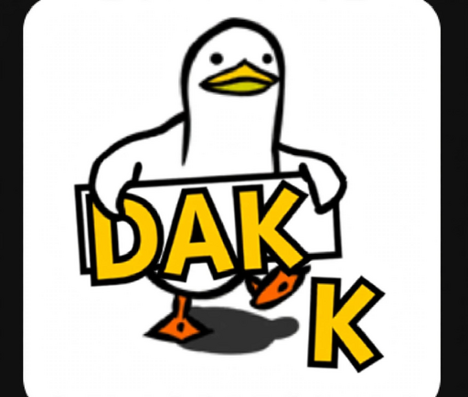

# Dakk — Uçtan Uca Şifreli Mesajlaşma

  

  <strong>Google hesabınla gir • QR kodla arkadaş ekle • Mesajların yalnızca sizde okunur</strong>

  
  
  
  

---

## Dakk nedir?

Dakk, arkadaşlarınla güvenle yazışman için tasarlanmış sade bir Android mesajlaşma uygulamasıdır.
Telefon numarası istemez, rehberini okumaz. Google hesabınla giriş yaparsın, arkadaşını QR kodla
veya bir bağlantıyla eklersin ve yazışmaya başlarsın.

Mesajların telefonundan çıkmadan önce şifrelenir. Sunucuda yalnızca okunamayan şifreli veri durur;
mesajı sadece sen ve karşındaki kişi açabilir.

## Özellikler

- 🔐 **Uçtan uca şifreleme** — Her mesaj cihazında şifrelenir; anahtarın Android Keystore ile korunur.
- 📨 **Çevrimdışı iletim** — Arkadaşın o an çevrimdışı olsa bile mesajın ona ulaşır.
- ✓✓ **Okundu bilgisi** — Gönderiliyor, gönderildi ve okundu göstergeleri.
- 📷 **Kolay arkadaş ekleme** — QR kod tara, galeriden QR seç, davet bağlantısı paylaş veya e-postayla ara.
- 🛡️ **Güvenlik numarası** — Sohbetin gerçekten doğru kişiyle olduğunu yüz yüze doğrula.
- 🚫 **Engelleme** — İstemediğin kişilerden gelen mesajları durdur.
- 🖼️ **Fotoğraf gönderme** — Fotoğraflar telefonda küçültülür ve uçtan uca şifrelenir. Alıcı açınca sunucudaki kopya silinir.
- ✨ **Dakk Asistan** — Uygulama içi yapay zekâ asistanı. Bir sohbette `@dakk` yazarak onu sohbete çağırabilirsin. Yapay zekâ tarafından işlenir; ilk kullanımda uyarı gösterilir.
- 😂 **Tepkiler** — Mesaja uzun bas, 😂 ❤️ ⭐ 👌 tepkilerinden birini bırak. Tepkiler de şifrelidir.
- ↩️ **Yanıtla** — Bir mesajı alıntılayarak yanıt ver.
- 🔎 **Sohbet arama** — Kişi adında ve son mesajlarda ara; Türkçe karakter yazmasan da bulur.
  Sohbetler en son konuşulandan eskiye sıralanır.
- 🗑️ **Herkesten sil** — Gönderdiğin mesajı iki taraftan da kaldır.
- 🔔 **Bildirimler** — Yeni mesaj geldiğinde, uygulama kapalıyken bile haber verir. Bildirimden
  *Cevapla*, *Görüldü* veya *❤️* ile uygulamayı açmadan işlem yapabilirsin. Kilit ekranında içerik,
  telefonunun gizlilik ayarına göre gizlenir.
- 📸 **Ekran görüntüsü bilgisi** — Sohbette ekran görüntüsü alınırsa karşı taraf küçük bir notla haberdar olur.
- 📣 **Duyurular** — Önemli haberler açılışta tam ekran gösterilir.
- ⬆️ **Otomatik güncelleme** — Yeni sürüm çıktığında uygulama içinden tek dokunuşla güncelle.
- 🌙 **Koyu tema** — Göz yormayan, OLED dostu tasarım.

## Kurulum

1. [Son sürüm sayfasından](https://github.com/cnrcrm20-ctrl/Dakk/releases/latest) `Dakk-vX.Y.Z.apk`
   dosyasını indir.
2. Telefonun sorarsa **bilinmeyen kaynaklardan yüklemeye** izin ver.
3. APK'yı aç ve **Yükle**'ye dokun.
4. Dakk'ı aç, **Google ile devam et**'e dokun.

Sonraki güncellemeler uygulamanın içinden gelir; yeniden APK indirmen gerekmez.

> **1.x sürümünden geçiyorsan:** 2.0 farklı bir imza anahtarıyla imzalandığı için eski uygulamayı
> bir kez **kaldırıp** yeni sürümü kurman gerekir. Bu yalnızca bir kereye mahsustur.

## Nasıl kullanılır?

| Ne yapmak istiyorsun? | Nasıl? |
| --- | --- |
| Arkadaş eklemek | Ana ekranda **Kişi ekle** → *QR kod tara*, *Galeriden QR seç* veya e-posta / davet bağlantısı yaz |
| Kendi kodunu göstermek | **Kişi ekle** → *QR kodumu göster* (veya Ayarlar → *Davet bağlantısı paylaş*) |
| Sohbeti doğrulamak | Sohbet → ⋮ → *Güvenlik numarası* — iki telefonda aynı sayılar görünmeli |
| Bir kişiyi engellemek | Sohbet → ⋮ → *Engelle* |
| Bir sohbeti bulmak | Sohbetler listesinin üstündeki *Sohbetlerde ara* çubuğu |
| Tepki bırakmak | Mesaja uzun bas → 😂 ❤️ ⭐ 👌 (kaldırmak için aynı tepkiye tekrar dokun) |
| Bir mesajı yanıtlamak | Mesaja uzun bas → *Yanıtla* |
| Mesajı kopyalamak | Mesaja uzun bas → *Kopyala* |
| Mesajı silmek | Mesaja uzun bas → *Herkesten sil* |
| Bildirimden yanıt vermek | Bildirimi aşağı çek → *Cevapla*, *Görüldü* veya *❤️* |
| Kilit ekranında mesajı gizlemek | Telefon Ayarları → Bildirimler → Kilit ekranı → *Hassas içeriği gizle* |
| Fotoğraf göndermek | Sohbet → mesaj kutusunun solundaki 🖼️ simgesi |
| Asistanla konuşmak | Sohbetler listesinin en üstündeki *Dakk Asistan* |
| Asistanı sohbete çağırmak | Mesajına `@dakk` ile başla, ör. `@dakk bu akşam ne yesek?` |
| Adını değiştirmek | Ayarlar → *Görünen ad* → *Adı düzenle* |
| Güncellemeyi elle kontrol etmek | Ayarlar → *Güncellemeleri denetle* |

## Bilinen sınırlamalar

- Xiaomi/Redmi/POCO gibi telefonlarda bildirimlerin uygulama kapalıyken de gelmesi için Dakk'ın
  **Otomatik başlatma** izni açık, pil tasarrufu **Kısıtlama yok** olmalıdır.
- Bir hesap aynı anda tek cihazda kullanılabilir. Yeni bir cihazda giriş yapıldığında eski cihazdaki
  mesajlar o cihazda okunamaz hale gelir (anahtarlar cihazdan dışarı çıkmaz).
- "Ekran görüntüsü aldı" bilgisi yalnızca ekran görüntüsünü alan kişinin telefonu **Android 14 veya
  üzeriyse** gönderilir. Daha eski Android sürümleri bunu uygulamalara bildirmez. Ekran kaydı algılanmaz.
- Şimdilik yazı ve fotoğraf gönderilebilir. Video, sesli mesaj ve grup sohbeti yoktur.
- Dakk Asistan ile yapılan sohbetler ve `@dakk` ile asistana gönderilen mesajlar uçtan uca şifreli değildir.

## Gizlilik ve güvenlik

- Ayrıntılar: [Gizlilik Politikası](PRIVACY_POLICY.md) • [Güvenlik Politikası](SECURITY.md)
- Güvenlik açığı bildirmek için lütfen herkese açık issue açma; `SECURITY.md`'deki yolu izle.

## Neden açık kaynak?

Dakk, Play Store'da değil; doğrudan bu sayfadan dağıtılıyor. Kaynak kodunun herkese açık olmasının
sebebi **güven**: uygulamanın mesajlarını okumadığını, rehberini toplamadığını ve gizli bir şey
yapmadığını herkes kendi gözüyle görebilir.

Resmi Dakk yalnızca [Releases](https://github.com/cnrcrm20-ctrl/Dakk/releases/latest) sayfasından
indirilir. Başka bir yerden gelen APK'lara güvenme.

## Lisans

[GNU AGPL-3.0](LICENSE)
